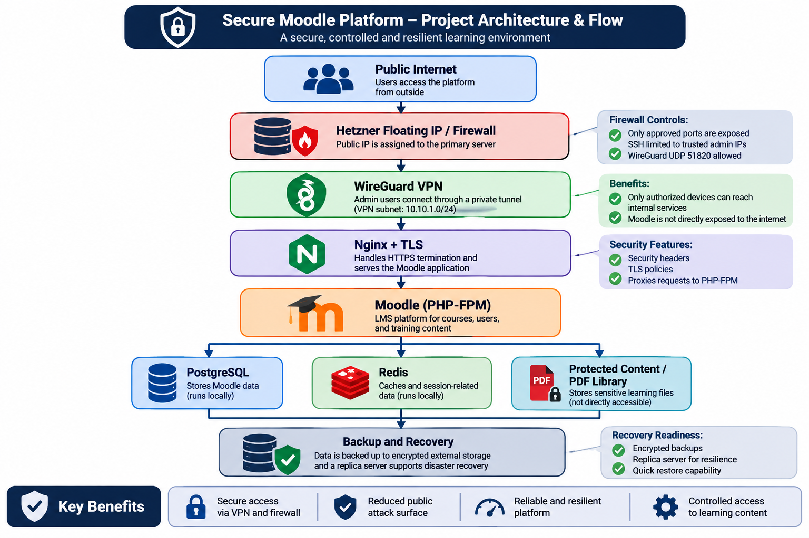
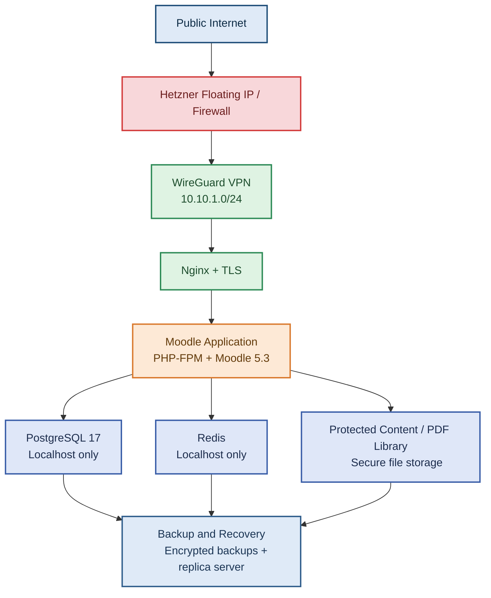

# MoodleShield Enterprise

A secure, self-hosted learning platform designed for organizations that need private, compliant, and resilient access to Moodle-based training and digital content.

This project delivers a production-oriented Moodle environment built on Debian 13, PostgreSQL 17, PHP 8.4, Nginx, Redis, and WireGuard. It is provisioned with Terraform and Ansible for repeatable deployment, hardened security, and operational continuity.

## Table of Contents

- [Overview](#overview)
- [Business Value](#business-value)
- [Architecture Flow](#architecture-flow)
- [Key Features](#key-features)
- [Repository Structure](#repository-structure)
- [Prerequisites](#prerequisites)
- [Quick Start](#quick-start)
- [Security Model](#security-model)
- [Reading Library Plugin](#reading-library-plugin)
- [SCORM Support](#scorm-support)
- [Backups and Disaster Recovery](#backups-and-disaster-recovery)
- [Air-Gapped Deployment](#air-gapped-deployment)
- [CI Pipeline](#ci-pipeline)
- [Technology Stack](#technology-stack)
- [License](#license)

## Overview

MoodleShield Enterprise is designed for teams and organizations that want to run Moodle in a controlled environment without depending on a public SaaS platform. The platform is intended for internal training, institutional learning, digital libraries, and secure knowledge delivery.

The solution combines:

- a hardened Moodle installation
- infrastructure automation with Terraform and Ansible
- secure private networking via WireGuard
- TLS termination and web security controls
- automated encrypted backups
- restore and disaster-recovery readiness
- support for offline / air-gapped deployments

## Business Value

This project is valuable for organizations that need:

- full control over their LMS environment
- private access to learning systems
- secure delivery of training and course materials
- reduced dependency on third-party hosted platforms
- stronger governance around user access and data
- resilience through backup and failover processes

For a business, the expected outcomes include:

- improved training delivery and learner experience
- reduced operational risk through automation and infrastructure control
- lower long-term licensing risk compared with SaaS alternatives
- a more secure internal training environment
- readiness for regulated or sensitive environments

## Architecture Flow



Sequence of the secure Moodle platform flow:



```text
Sequence of the secure Moodle platform flow:

1) Public Internet
   Users access the platform from outside the organization.

2) Hetzner Floating IP / Firewall
   Public IP is assigned to the primary server.
   Firewall restricts exposure to approved ports only:
   - SSH to trusted admin IPs
   - WireGuard UDP 51820
   - HTTPS only through the internal VPN path

3) WireGuard VPN
   Admin users connect through a private tunnel.
   VPN subnet: 10.10.1.0/24
   Access to internal services is restricted to authorized devices only.

4) Nginx + TLS
   Nginx handles HTTPS termination and security headers.
   It receives requests, enforces TLS policy, and proxies traffic to Moodle.

5) Moodle Application (PHP-FPM)
   Moodle runs securely behind the web layer.
   It manages courses, users, training content, and learner access.

6) PostgreSQL and Redis
   PostgreSQL stores Moodle data locally.
   Redis handles cache and session data locally.
   Both services remain isolated from the public internet.

7) Protected Content / PDF Library
   Sensitive learning files and PDF content are stored in a protected location.
   They are not directly exposed to the web.

8) Backup and Recovery
   Data is backed up to encrypted external storage.
   Replica-server readiness supports disaster recovery and fast restoration.

+----------------------------------------------------------------------------------+
|                                Public Internet                                  |
|  Users access the platform from outside the organization                         |
+--------------------------------------------+-------------------------------------+
                                             │
                                             ▼
+--------------------------------------------+-------------------------------------+
|                  Hetzner Floating IP / Firewall                                |
|  Public IP assigned to primary server                                            |
|  - SSH restricted to trusted admin IPs                                          |
|  - UDP 51820 allowed for WireGuard                                              |
|  - HTTPS access limited to VPN path                                             |
+--------------------------------------------+-------------------------------------+
                                             │
                                             ▼
+--------------------------------------------+-------------------------------------+
|                          WireGuard VPN (10.10.1.0/24)                         |
|  Admin users connect through a private tunnel                                  |
|  Internal services remain protected from direct internet access                |
+--------------------------------------------+-------------------------------------+
                                             │
                                             ▼
+--------------------------------------------+-------------------------------------+
|                          Nginx + TLS Layer                                     |
|  HTTPS termination, security headers, reverse proxy to Moodle                  |
+--------------------------------------------+-------------------------------------+
                                             │
                                             ▼
+--------------------------------------------+-------------------------------------+
|                     Moodle Application (PHP-FPM + Moodle 5.3)                   |
|  LMS platform for courses, users, content, and learning workflows              |
+--------------------------------------------+-------------------------------------+
                                             │
                    ┌------------------------┬------------------------┐
                    │                        │                        │
                    ▼                        ▼                        ▼
       +--------------------+   +--------------------+   +------------------------+
       | PostgreSQL 17      |   | Redis              |   | Protected Content /     |
       | Stores Moodle data |   | Cache & sessions   |   | PDF Library            |
       | Localhost only     |   | Localhost only     |   | Secure file storage    |
       +--------------------+   +--------------------+   +------------------------+
                    │                        │                        │
                    └------------------------┴------------------------┘
                                             │
                                             ▼
+--------------------------------------------+-------------------------------------+
|                           Backup and Recovery                                  |
|  Encrypted backups, offsite retention, and replica-server readiness            |
+--------------------------------------------+-------------------------------------+
```

This architecture minimizes public exposure while preserving secure admin access to the LMS environment. Public traffic is controlled at the edge, internal services remain restricted behind the VPN, and the application stack is designed for resilience, recovery, and secure content handling.

## Key Features

- Secure, private-access model using WireGuard
- Terraform-based infrastructure provisioning on Hetzner Cloud
- Ansible-managed full-stack provisioning and configuration
- Hardened Nginx configuration with security headers
- TLS enforcement and certificate management
- PostgreSQL and Redis restricted to local connections
- Custom Reading Library module for controlled PDF lending
- Automated daily encrypted backups to Backblaze B2
- Restore and replica-server disaster recovery support
- Offline deployment support for restricted or air-gapped environments

## Repository Structure

```text
moodleshield-enterprise/
├── .github/workflows/                 CI pipeline for Terraform, Ansible, PHP, and security scans
├── ansible/                           Provisioning playbooks and roles
│   └── roles/
│       ├── backup/
│       ├── base/
│       ├── moodle/
│       ├── nginx/
│       ├── php/
│       ├── postgres/
│       ├── redis/
│       ├── tls/
│       └── wireguard/
├── docs/
│   ├── architecture/
│   ├── deployment/
│   ├── disaster-recovery/
│   └── evidence/
├── examples/
│   └── scorm-sample/
├── moodle/
│   ├── config/
│   └── plugins/
│       └── mod_readinglibrary/
├── nginx/
│   └── moodle.conf
├── scripts/
│   ├── backup/
│   ├── install/
│   ├── offline/
│   └── restore/
├── terraform/
│   ├── main.tf
│   ├── outputs.tf
│   ├── variables.tf
│   └── terraform.tfvars.example
├── tests/
│   ├── integration/
│   ├── performance/
│   └── security/
├── wireguard/
│   └── client.conf.example
├── LICENSE
├── README.md
└── ansible.cfg
```

## Prerequisites

| Tool | Version |
|------|---------|
| Terraform | 1.6 or newer |
| Ansible | 2.16 or newer |
| Python | 3.11 or newer |

## Quick Start

### 1. Generate a deploy key

```bash
ssh-keygen -t ed25519 -f ~/.ssh/moodleshield -C "moodleshield-deploy"
```

### 2. Create the Ansible vault

```bash
ansible-vault create ansible/group_vars/vault.yml
```

Example variables:

```yaml
vault_moodle_admin_pass:     <strong-password>
vault_pg_pass:               <strong-password>
vault_redis_pass:            <strong-password>
vault_restic_password:       <strong-password>
vault_b2_account_id:         <backblaze-account-id>
vault_b2_account_key:        <backblaze-application-key>
vault_wg_server_private_key: <output-of-wg-genkey>
```

### 3. Set Terraform variables

```bash
export TF_VAR_hcloud_token="<hetzner-api-token>"
export TF_VAR_admin_source_ips='["<your-static-ip>/32"]'
```

### 4. Provision the environment

```bash
bash scripts/install/provision.sh
```

This workflow provisions the VPS infrastructure, configures networking, and runs the full stack deployment sequence.

### 5. Connect through WireGuard

Use the sample configuration in [wireguard/client.conf.example](wireguard/client.conf.example) to connect a management device to the private VPN and access the environment securely.

### 6. Run validation tests

```bash
MOODLE_HOST=lms.example.com MOODLE_PASS=<pass> bash tests/integration/integration_test.sh
MOODLE_HOST=lms.example.com bash tests/security/security_test.sh
```

## Security Model

The design follows a private-access model for production use:

- SSH is restricted to trusted admin IPs
- WireGuard provides a private network tunnel for administrators
- Moodle is only reachable via the internal network path
- PostgreSQL and Redis are bound to local interfaces only
- Nginx applies secure headers and TLS policies
- Sensitive files and resource paths are blocked from direct web access
- Backups are encrypted and stored externally

## Reading Library Plugin

A custom Moodle activity module named mod_readinglibrary implements a managed digital lending workflow for PDF-based learning resources.

Key features:

- teachers upload protected PDF files outside the web root
- borrowers receive short-lived access tokens
- files are streamed securely instead of being directly exposed
- token rotation and return logic prevent uncontrolled reuse
- license limits help prevent over-lending
- Arabic RTL language support is included

## SCORM Support

The project includes a sample SCORM package in [examples/scorm-sample](examples/scorm-sample) for validation of course content launch and completion tracking.

To package the sample:

```bash
cd examples/scorm-sample && zip -r ../moodleshield-sample-scorm.zip .
```

## Backups and Disaster Recovery

The environment is designed with recovery in mind:

- encrypted daily backups using Restic
- Backblaze B2 storage for offsite retention
- backup of PostgreSQL data, the Moodle web root, and Moodle data files
- retention policy covering daily, weekly, and monthly points
- replica-server recovery workflow for low RTO targets

## Air-Gapped Deployment

The project supports restricted-network deployments via a local package mirror.

```bash
bash scripts/offline/build_mirror.sh /opt/moodleshield-mirror
```

This creates a local APT mirror with indexed packages and checksums so the system can be deployed without internet connectivity.

## CI Pipeline

The project includes automated validation for:

- Terraform formatting and validation
- Ansible linting
- PHP static analysis
- Shell script linting
- vulnerability and secret scanning
- integration and security test execution

## Technology Stack

| Layer | Technology |
|-------|------------|
| Operating System | Debian 13 |
| LMS | Moodle 5.3 |
| Database | PostgreSQL 17 |
| Application Runtime | PHP 8.4 + PHP-FPM |
| Web Server | Nginx |
| Cache | Redis |
| Cloud Platform | Hetzner Cloud |
| Infrastructure as Code | Terraform |
| Configuration Management | Ansible |
| VPN | WireGuard |
| TLS | Let's Encrypt |
| Backup | Restic + Backblaze B2 |
| CI/CD | GitHub Actions |

## License

This project is distributed under the MIT license. See [LICENSE](LICENSE) for details.
